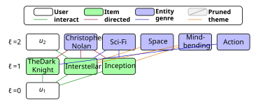
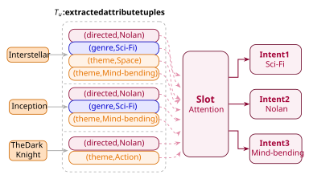
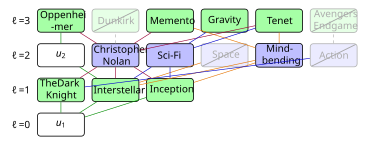

# KISS: Knowledge-aware Intent-guided Subgraph Sampling

[](https://link.springer.com/chapter/10.1007/978-981-92-5696-9_9)
[](https://doi.org/10.1007/978-981-92-5696-9_9)

Official implementation of **"Knowledge-Aware Intent-Guided Subgraph Sampling for Recommendation"**, published in *Web and Big Data* (APWeb-WAIM 2026), Springer, pp. 129–145.

KISS is a user-centric subgraph learning framework for knowledge-enhanced recommendation. It derives latent user intents from KG attributes of interacted items (via Slot Attention) and uses them to guide adaptive node sampling during multi-hop subgraph expansion. This cuts computation and memory costs while keeping accuracy competitive with state-of-the-art methods.

| Subgraph Construction | Intent Modelling | Intent-guided Sampling |
|:---:|:---:|:---:|
|  |  |  |

## Installation

Requires Python ≥ 3.10 and an NVIDIA GPU with CUDA 12.x.

```bash
git clone https://github.com/tinta2510/GraphKISS.git
cd GraphKISS
bash scripts/install.sh        # CUDA 12.8 + PyTorch 2.8 (default)
bash scripts/install.sh cu121  # CUDA 12.1 + PyTorch 2.3.1
```

## Data

Datasets live under `data/<name>/`: `last-fm`, `amazon-book`, and their inductive-split variants `new_last-fm`, `new_amazon-book`. Each has its own config in `configs/<name>.yaml`.

## Training

```bash
python train.py --data_path data/last-fm/ --config configs/last-fm.yaml --gpu 0
# or
bash scripts/run_single.sh last-fm 0
```

Override config values and tag a run:

```bash
python train.py --data_path data/last-fm/ --config configs/last-fm.yaml \
  --override K_intent=8 --override lr=5e-4 --tag myrun
```

Add `--deterministic` for reproducibility. Metrics (Recall@20, NDCG@20), per-epoch logs, and the best checkpoint are written to `results/`.

## Citation

```bibtex
@InProceedings{10.1007/978-981-92-5696-9_9,
  author    = "Ta, Trung-Tin and Vo, Hoang-Huy and Thoai, Nam",
  editor    = "Ding, Lingling and Manolopoulos, Yannis and Chbeir, Richard and Bou-chaaya, Karam and Dustdar, Schahram and Tuan, Tran Ngoc",
  title     = "Knowledge-Aware Intent-Guided Subgraph Sampling for Recommendation",
  booktitle = "Web and Big Data",
  year      = "2027",
  publisher = "Springer Nature Singapore",
  address   = "Singapore",
  pages     = "129--145",
  isbn      = "978-981-92-5696-9",
  doi       = "10.1007/978-981-92-5696-9_9"
}
```

## License

Apache License 2.0 — see [LICENSE](LICENSE).
